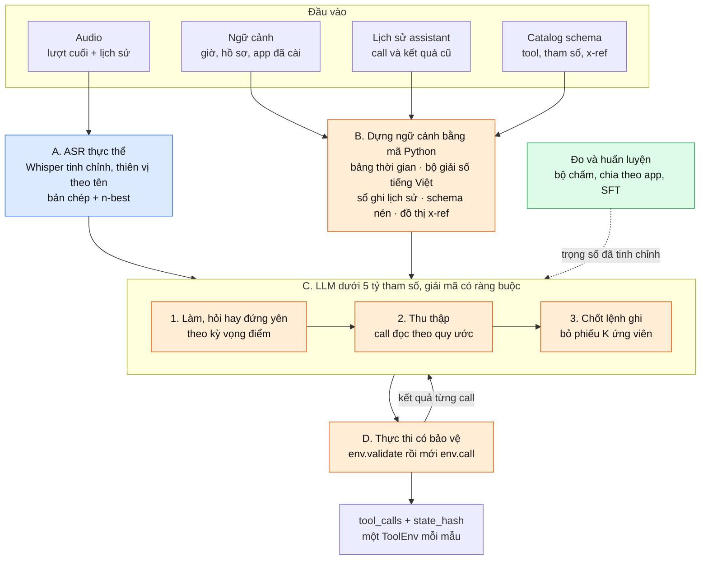

# LifeMate: đề xuất pipeline (ZAIC 2026)

_Nguyen tran Minh Nhat · cập nhật 03/11/2026_

**Đề xuất:** một agent chạy offline gồm Whisper tinh chỉnh (khoảng 0,8 tỷ tham số) và một LLM khoảng 4 tỷ tham số đã SFT. Mọi tham số quyết định `state_hash` (ID, ngày giờ, số tiền) do mã tất định đưa ra, LLM chỉ được chọn trong tập đó.

**Vì sao cần khác biệt:** bảng public đã ở 96,5 sau một tuần, còn 65% mẫu public dùng app chưa có trong train. Thắng thua sẽ phân ở private, nơi app mới và giọng mới xuất hiện.

**Ba điểm khác biệt chính:** ràng buộc nguồn gốc tham số ngay lúc giải mã; chính sách gọi call đọc học từ dữ liệu và suy rộng sang app mới qua `x-ref`; bỏ phiếu trên chữ ký lệnh ghi thay vì trên chữ.

**Cần bạn quyết:**

- [ ] Nhận kiến trúc hai pha thu thập rồi chốt, cùng ràng buộc nguồn gốc tham số, làm hướng chính.
- [ ] Chọn LLM nền sau khi đo ở nấc 1 (mục 6), không chọn trước.
- [ ] Dùng điểm trên tập giữ lại theo app làm thước đo chính thay cho điểm public.

## 1. Đề bài nhìn từ hàm điểm

Điểm của một mẫu là 0 nếu `state_hash` sai, và là F1 của danh sách call nếu hash đúng. Mọi quyết định kiến trúc bên dưới đều xuất phát từ hai tầng chấm này.

**Cách chấm** (tab Evaluation trên trang thi và mã `zaic_tools`):

- **Cổng state:** BTC replay `tool_calls` đã nộp trên `state.json` gốc bằng đúng gói `zaic_tools`. Hash lệch đáp án thì mẫu được 0.
- **Khớp call:** cùng tên tool, mọi tham số không-fuzzy giống hệt, tham số fuzzy có token-F1 > 0,6. Không xét thứ tự, mỗi call chỉ khớp một lần.
- **Công thức:** P = M / (M + U), R = M / |G|, điểm mẫu = F1. U gồm cả call bị từ chối vì sai schema.
- **Mẫu ngoài phạm vi** (gold rỗng): được 1 chỉ khi nộp danh sách rỗng, gọi bất kỳ call nào là 0.
- **`sys.ask_missing_info`** được chấm như mọi tool khác, tức `tool_name` và `params` phải đúng.

**Hash thật ra so cái gì.** Hàm `canon()` bỏ `_meta`, bỏ các app thông tin (weather, gold\_price, fuel\_price, exchange\_rate, lottery) và bỏ 12 trường văn bản tự do (`title`, `body`, `content`, `name`, `address`, `location`, `note`, `label`, `subject`, `pickup`, `dropoff`, `expression`). Chuỗi được hạ chữ thường, gộp khoảng trắng, `700 cm` bằng `700cm`. Vậy hash chỉ nhạy với **tham số có cấu trúc**: ID, ngày giờ, số tiền, enum, boolean.

**Thứ tự call không được chấm, nhưng vẫn đổi được hash.** `App.new_id()` cấp ID theo số bản ghi hiện có, và danh sách bản ghi giữ thứ tự. Hai lệnh tạo mới trên cùng một danh sách mà đảo thứ tự thì ID và vị trí đổi, hash lệch.

**Giá của một lỗi nhỏ** (tính từ công thức trên, hash vẫn đúng):

| Số call gold \|G\| | Thừa 1 call | Thiếu 1 call đọc | Sai tham số 1 call |
| --- | --- | --- | --- |
| 1 | 0,67 | 0 | 0 |
| 2 | 0,80 | 0,67 | 0,50 |
| 3 | 0,86 | 0,80 | 0,67 |
| 4 | 0,89 | 0,86 | 0,75 |

Thiếu hoặc sai một call **ghi** gần như luôn làm lệch hash, tức 0 điểm. Thừa một call đọc ở mẫu một-call mất một phần ba điểm.

**Ràng buộc phần cứng và mô hình:** tổng tham số dưới 6 tỷ, riêng LLM dưới 5 tỷ, ngữ cảnh 16K, 30 giây mỗi mẫu trên một GPU A30, chạy offline trong Docker, mô hình công bố trước 01/10/2026 với giấy phép cho phép dùng.

**Luật cấm đi đường tắt:** mỗi mẫu một `ToolEnv` duy nhất, không tạo lại để thử rồi làm lại, không đọc thẳng `state.json`. Top 2 bị BTC chạy lại và đọc mã, nên mọi ý tưởng bên dưới đều nằm trong luật này.

## 2. Insight từ dữ liệu

Bài này không phải "gọi đúng tool" chung chung. Nó là bài tái hiện đúng **quy ước của bộ sinh đáp án**, cả ở call đọc, trên những app chưa thấy bao giờ. Các con số dưới đây đo trên 1.545 mẫu train và 634 mẫu public test.

| Phát hiện | Số liệu | Hệ quả cho thiết kế |
| --- | --- | --- |
| Public test dùng app chưa có trong train | 11 trong 36 app là mới; 410/634 mẫu (65%) có ít nhất một app mới | Không học thuộc tên tool. Agent phải đọc schema và suy ra cách dùng. Private gần như chắc có thêm app mới |
| Call đọc nằm trong đáp án | 1.599 call đọc so với 1.725 call ghi; 1.073/1.545 mẫu (69%) có call đọc | Call đọc không phải chi phí phụ. Gọi thừa hay thiếu đều mất F1, nên cần một chính sách đọc riêng |
| ID không bao giờ đoán | 1.231 giá trị ID trong call ghi: 922 lấy từ kết quả đọc ngay lượt đó, 308 từ lịch sử, 1 không rõ nguồn | Mọi ID đưa vào call ghi phải truy được nguồn. Có thể ép điều này ngay lúc giải mã |
| Lịch sử được dùng lại | Khi mọi ID cần đã có trong lịch sử, gold dùng lại luôn 241 lần, đọc lại 67 lần (78% dùng lại) | Cần một "sổ ghi" các thực thể đã biết từ lịch sử, và quy tắc khi nào đọc lại |
| Điều kiện đã trả lời trong lịch sử | `train_0082`: "mai mà mưa thì dời lịch…", lịch sử đã có dự báo không mưa, gold rỗng | Phải suy luận trên lịch sử trước khi gọi. Gọi `weather` thêm một lần ở đây là 0 điểm |
| Câu có điều kiện và tự sửa | 145 câu "nếu… không thì…"; 107 câu "à mà thôi", "nhầm" | Chỉ làm phần người dùng chốt cuối cùng. Cần hiểu ngữ nghĩa chứ không chỉ trích ý định |
| Ba kiểu phản ứng | Làm: 1.217 (79%); hỏi lại: 217 (14%); đứng yên: 111 (7%) | Quyết định làm/hỏi/đứng yên đáng một bộ phân định riêng có hiệu chỉnh |
| Hỏi lại sau khi làm một phần | 157/217 mẫu hỏi lại có call khác đi trước, ví dụ đặt báo thức rồi mới hỏi gọi Minh nào | "Hỏi" là một bước trong kế hoạch, không phải nhãn cả mẫu |
| Truy vấn tìm kiếm theo quy ước | `contacts.search`: 199/234 lần query đúng chữ người dùng nói; 35 lần khác, ví dụ nói "cô Mai" nhưng query là "Cô giáo Mai", hoặc query rỗng khi soạn email | Tham số call đọc cũng phải khớp tuyệt đối. Quy ước này học được từ train |
| Tìm kiếm là so chuỗi con | `contacts.search` so chuỗi con không dấu trên tên, quan hệ, số điện thoại | "cô Mai" không tìm ra "Cô giáo Mai". Query sai là tốn thêm call để tìm lại |
| Nhiều lệnh ghi trong một câu | 475 mẫu có hơn một call ghi; 144 mẫu gọi cùng một tool ghi hai lần | Thứ tự tạo mới ảnh hưởng hash, phải theo đúng thứ tự người nói |
| Tham số ngày giờ | 404/1.725 call ghi có ngày giờ, đều tính từ `current_time` | "Mai", "6 rưỡi", "thứ Bảy tuần sau" phải do bộ giải tất định xử lý, không để LLM tự tính |
| Tham số fuzzy | 536/1.725 call ghi (31%) có trường văn bản tự do, ngưỡng token-F1 0,6 | Chép nguyên cụm từ người dùng nói là an toàn nhất; các trường này không đụng hash |
| Lịch sử hội thoại | 66% mẫu có lịch sử, dài tới 24 lượt; lượt user trong lịch sử chỉ có audio | Phải ASR cả lịch sử, hoặc tóm lịch sử từ lời và call của assistant |
| Kích thước schema | Trung vị 30 tool mỗi mẫu; schema thô trung vị 11,6 nghìn ký tự, lớn nhất 23,7 nghìn | Nhét schema thô cộng lịch sử dài dễ vượt 16K. Cần nén schema |
| Audio | Trung vị 7,2 giây, p95 13,5 giây ở public | ASR không phải nút thắt thời gian. Nút thắt là số vòng LLM |

**Bảng xếp hạng đã sát trần.** Ngày 03/11, top 1 mô hình nhỏ đạt 96,51, hạng 10 đạt 91,67. Đội thắng sẽ là đội giữ điểm trên private với app mới và giọng mới, không phải đội nhích thêm 0,5 điểm public. Vài đội có điểm API 95–96 nhưng mô hình nhỏ chỉ 73, cho thấy khoảng cách thật nằm ở chỗ ép mô hình nhỏ làm đúng.

**Dấu hiệu dữ liệu sinh từ mẫu câu.** Nhiều câu lặp gần nguyên văn, ví dụ "Đặt báo thức 6 rưỡi sáng mai với gọi cho Minh". Quy ước của bộ sinh vì vậy ổn định và học được, nhưng mô hình cũng dễ học vẹt nếu chỉ đo trên mẫu ngẫu nhiên.

## 3. Kiến trúc tổng thể

Màu theo mảng việc: xanh dương là Giọng nói, cam là Lõi agent, xanh lá là Dữ liệu, đo và huấn luyện.

Audio đi qua ASR (A); ngữ cảnh, lịch sử và catalog đi qua mã Python (B). LLM (C) quyết định kiểu phản ứng, thu thập bằng call đọc, rồi bỏ phiếu trước khi ghi. Mỗi call đi qua D, kết quả quay lại C. Chi tiết từng khối ở mục 4, lý do thiết kế ở mục 5.

## 4. Chi tiết từng tầng

Nguyên tắc chung: LLM chỉ làm việc cần hiểu ngôn ngữ. Mọi thứ tính được bằng mã tất định (ngày, số, ID, schema) thì mã làm, và LLM chỉ chọn trong các giá trị mã đưa ra.

### A. Tiền xử lý giọng nói

- **Mô hình:** một Whisper đã tinh chỉnh tiếng Việt. Ứng viên: PhoWhisper (VinAI) và Whisper large-v3-turbo (809 triệu tham số). Chốt sau khi đo WER và độ đúng tên riêng trên train.
- **Tinh chỉnh trên dữ liệu thi:** train có `audio_text` cho lượt cuối và cả các lượt user trong lịch sử, nên có nhiều cặp audio–văn bản hơn 1.545.
- **Thiên vị theo ngữ cảnh:** mỗi mẫu dựng một danh sách từ khoá gồm tên trong lịch sử, tên thiết bị, địa điểm trong `user_profile`, và các tên liên hệ hay gặp trong train. Đưa vào Whisper dưới dạng prompt mồi.
- **Đầu ra:** bản tốt nhất, vài bản thay thế (beam 4), và độ tin cậy từng đoạn. Đoạn tin cậy thấp được đánh dấu cho tầng sau.
- **Không chuẩn hoá số ở đây.** "Hai triệu tám" giữ nguyên chữ để bộ giải số ở tầng B xử lý có kiểm soát.

### B. Dựng ngữ cảnh (mã Python, không dùng mô hình)

- **Bảng thời gian:** từ `current_time` sinh sẵn "hôm nay", "mai", "mốt", các thứ tuần này và tuần sau, "cuối tuần", cùng mặc định sáng/trưa/chiều/tối học từ train. LLM tra bảng, không tự cộng ngày.
- **Bộ giải số tiếng Việt:** "năm mươi nghìn" ra 50.000, "hai triệu tám" ra 2.800.000, "6 rưỡi" ra 06:30. Trả về tập ứng viên khi câu nói mơ hồ.
- **Địa điểm trong hồ sơ:** "về nhà", "ở công ty" ánh xạ sang địa chỉ trong `user_profile`.
- **Sổ ghi lịch sử:** đọc mọi `tool_calls` và `tool_results` của assistant trong lịch sử, rút ra bảng thực thể có ID (liên hệ, lịch, thiết bị, hoá đơn, bản ghi vừa tạo) và bảng sự kiện đã biết (mai không mưa, giá vàng mua vào 130,8 triệu).
- **Nén schema:** mỗi tool còn một dòng, ví dụ `sms.send(contact_id | phone_number, content~) [ghi]`, kèm enum và nguồn `x-ref`. Mục tiêu: cả bộ tool của một mẫu dưới khoảng 4 nghìn token.
- **Đồ thị phụ thuộc từ schema:** tham số có `x-ref: contacts.contacts` nối tới các tool đọc của app `contacts` trả về danh sách đó. Đồ thị này dựng được cho cả app chưa thấy.

### C. Lập kế hoạch (LLM dưới 5 tỷ tham số)

- **Mô hình:** ứng viên Qwen3-4B, Phi-4-mini (3,8 tỷ), Gemma 3 4B. Cần kiểm lại ngày công bố và giấy phép trước khi chốt.
- **Vòng lặp từng bước:** đầu vào gồm schema đã nén, bảng thời gian, sổ ghi lịch sử, bản chép lời (kèm bản thay thế cho đoạn tin cậy thấp) và các call đã gọi. Đầu ra là một hành động JSON: gọi tool, hỏi lại, hoặc dừng.
- **Giải mã có ràng buộc:** ngữ pháp JSON dựng từ schema của chính mẫu đó. Tên tool chỉ nằm trong tool đã cài, kiểu và enum đúng schema. Kết quả: không còn call bị từ chối.
- **Huấn luyện:** SFT trên quỹ đạo gold của train, mỗi bước là một cặp (ngữ cảnh đến hành động kế). Một nửa mẫu dùng bản chép lời từ ASR thật thay cho `audio_text`, để mô hình quen với lỗi nhận dạng.
- **Chống học thuộc app:** khi huấn luyện, đổi tên app, tool, tham số và viết lại mô tả một cách ngẫu nhiên. Mô hình buộc phải đọc schema để làm đúng (xem mục 5).

### D. Thực thi có bảo vệ

- Gọi `env.validate` trước mọi call. Không hợp lệ thì trả lỗi về cho LLM, không tốn call nào.
- Kết quả `done: false`, danh sách rỗng hay nhiều kết quả khớp đều được đưa lại cho LLM. Cách xử lý (hỏi lại hay tìm cách khác) học từ train, ví dụ "gọi cho Lan" mà có hai Lan thì hỏi `contact_id`.
- Chặn vòng lặp: tối đa khoảng 8 bước, không lặp lại call giống hệt.

### E. Chốt lệnh ghi

- Kế hoạch chia hai pha: **thu thập** (các call đọc theo quy ước) rồi **chốt** (các call ghi). Trước lệnh ghi đầu tiên, hệ thống bỏ phiếu trên tập lệnh ghi (mục 5).
- Đầu ra cuối: `env.get_tool_calls()` và `env.get_state_hash()`, đúng một `ToolEnv` mỗi mẫu.

## 5. Điểm khác biệt

Cách làm phổ biến là ASR rồi đưa schema thô vào một LLM chạy ReAct tự do. Nó để LLM tự gõ ID, tự cộng ngày, tự đoán khi nào cần đọc, và đó chính là ba nguồn mất điểm lớn nhất theo mục 1. Sáu ý tưởng dưới đây đánh thẳng vào cấu trúc hàm điểm.

### 5.1. Tham số có nguồn gốc: LLM chọn, không gõ

- **Ý tưởng:** chia tham số thành ba loại. Loại đụng hash (ID, ngày giờ, số tiền, enum) chỉ được lấy từ một tập ứng viên có nguồn. Loại văn bản tự do chép từ câu nói. Loại tham số của call đọc theo quy ước (5.2).
- **Cách làm:** ngữ pháp giải mã được dựng lại ở mỗi bước. Khi sinh `contact_id`, tập giá trị cho phép chính là các ID liên hệ đã xuất hiện trong sổ ghi hoặc kết quả đọc. Khi sinh ngày giờ, tập cho phép là bảng thời gian cộng các ngày nói rõ trong câu.
- **Vì sao khớp hàm điểm:** một ID bịa ra không bị từ chối. Tool chạy, trả `done: false`, không đổi state, và mẫu mất trắng mà không có báo lỗi nào. Ràng buộc lúc giải mã xoá hẳn lớp lỗi này.
- **Cách đo:** tỉ lệ mẫu sai hash do sai ID, sai ngày giờ, sai số tiền, trước và sau khi bật ràng buộc.

### 5.2. Chính sách đọc học từ dữ liệu, suy rộng bằng đồ thị schema

- **Ý tưởng:** coi "khi nào đọc, đọc tool nào, với tham số gì" là một chính sách cần học, không phải thói quen của LLM.
- **Cách làm:** khai thác train để có bảng quy ước, ví dụ "query = tên như người dùng nói", "ID đã có trong lịch sử thì không đọc lại", "soạn email thì liệt kê danh bạ". Với app mới, suy ra tool đọc tiên quyết từ liên kết `x-ref` trong catalog.
- **Vì sao khớp hàm điểm:** 69% mẫu có call đọc trong gold. Ở mẫu ba call, đọc thừa hay thiếu một lần là mất 14–20% điểm dù hash đúng.
- **Cách đo:** precision và recall riêng trên call đọc, tách theo app đã thấy và app chưa thấy.

### 5.3. Bỏ phiếu trên tập lệnh ghi, không bỏ phiếu trên chữ

- **Ý tưởng:** ở mỗi bước ghi, sinh K ứng viên (K khoảng 4–5, seed cố định), quy mỗi ứng viên về **chữ ký ghi**: tên tool cộng các tham số không-fuzzy. Chọn chữ ký được nhiều phiếu nhất, rồi mới gọi.
- **Vì sao khớp hàm điểm:** hash chỉ phụ thuộc chữ ký ghi, nên bỏ phiếu đúng ở tầng đó. Hai ứng viên chỉ khác cách diễn đạt nội dung tin nhắn được tính là một phiếu.
- **Hợp lệ với luật:** các ứng viên chỉ là văn bản do LLM sinh, chưa chạy trên môi trường. Không tạo lại `ToolEnv`, không thử rồi làm lại.
- **Cách đo:** điểm trên tập kiểm định với K = 1, 3, 5, và thời gian thêm mỗi mẫu.

### 5.4. Quyết định làm, hỏi hay đứng yên theo kỳ vọng điểm

- **Ý tưởng:** tách quyết định này khỏi vòng ReAct. LLM chấm xác suất ba lựa chọn, rồi chọn theo kỳ vọng điểm, không theo xác suất cao nhất.
- **Vì sao khớp hàm điểm:** chi phí sai không đối xứng. Mẫu gold rỗng mà gọi một call là 0. Mẫu cần hỏi mà lại đoán tham số và ghi thì gần như chắc lệch hash.
- **Lưu ý từ dữ liệu:** 72% mẫu hỏi lại có làm phần khác trước, nên quyết định này được đưa ra cho từng ý định trong câu, không cho cả mẫu.
- **Cách đo:** ma trận nhầm lẫn làm/hỏi/đứng yên trên tập kiểm định, và điểm trước và sau khi hiệu chỉnh ngưỡng.

### 5.5. Huấn luyện để đọc schema, không để nhớ app

- **Ý tưởng:** 65% mẫu public dùng app chưa thấy, và private có thể còn nhiều hơn. Mô hình phải thắng nhờ đọc schema, không nhờ nhớ tên tool.
- **Cách làm:** khi SFT, đổi tên nhất quán app, tool và tham số trong cả schema lẫn đáp án, viết lại mô tả, bỏ bớt tool không liên quan. Thêm app tổng hợp kiểu CRUD viết trên lớp `App` có sẵn, để có cả dữ liệu lẫn hash kiểm tra được.
- **Cách đo:** đánh giá bằng tập **giữ lại theo app** (mục 7). Đây là con số gần nhất với điểm private.

### 5.6. ASR gắn với thực thể

- **Ý tưởng:** lỗi ASR chỉ đáng sợ khi rơi vào tên riêng, số và giờ. Thay vì tối ưu WER chung, tối ưu độ đúng của các đoạn đi vào tham số.
- **Cách làm:** thiên vị ASR theo danh sách tên của từng mẫu. Với đoạn tin cậy thấp nằm trong một tham số, đưa các bản thay thế cho LLM và ưu tiên bản khớp với thực thể đã biết, ví dụ lịch sử có "Hương" thì chọn "Hương" thay vì "Hường".
- **Vì sao khớp hàm điểm:** tool tìm kiếm bỏ dấu nên hash vẫn đúng khi sai dấu, nhưng query trong call phải khớp đúng chính tả mới được tính. Sửa đúng tên là lấy lại phần F1 đó.
- **Cách đo:** độ đúng tên riêng và số trong bản chép lời, và khoảng cách điểm giữa chạy bằng `audio_text` gold và chạy bằng ASR.

## 6. Lộ trình kỹ thuật: từ dễ đến khó

Mỗi nấc là một phiên bản nộp được. Chỉ lên nấc sau khi cổng của nấc trước đã qua trên tập kiểm định cục bộ. Mỗi nấc nộp public một lần để kiểm tra điểm cục bộ có bám điểm public không.

1. **Nấc 0: khung đo.** Bộ chấm viết lại đúng công thức, trình chạy cả tập, hai cách chia tập, bảng phân loại lỗi.
   - Cổng: chạy lại call gold của train cho đúng 100 điểm và state khớp `final_state` ở mọi mẫu.
2. **Nấc 1: baseline nộp được.** Whisper có sẵn, LLM 4B chỉ dùng prompt, schema thô, ReAct, `env.validate` trước mọi call.
   - Cổng: file nộp hợp lệ, dưới 30 giây mỗi mẫu trên GPU tương đương A30, có số đo gốc trên cả hai tập kiểm định.
3. **Nấc 2: tất định hoá phần đụng hash.** Bảng thời gian, bộ giải số, sổ ghi lịch sử, nén schema, giải mã JSON theo schema.
   - Cổng: không còn call bị từ chối; số mẫu sai hash vì ngày giờ và số tiền giảm rõ so với nấc 1.
4. **Nấc 3: tinh chỉnh LLM.** SFT trên quỹ đạo train có nhiễu ASR, đổi tên app khi huấn luyện, gợi ý quy ước đọc đã khai thác.
   - Cổng: điểm trên tập giữ lại theo app tiệm cận điểm trên tập ngẫu nhiên; precision và recall call đọc đều tăng.
5. **Nấc 4: các ý tưởng khác biệt.** Ràng buộc nguồn gốc tham số (5.1), bỏ phiếu lệnh ghi (5.3), quyết định theo kỳ vọng điểm (5.4).
   - Cổng: gần như không còn mẫu sai hash vì ID; phần điểm tăng từ bỏ phiếu lớn hơn rủi ro về thời gian.
6. **Nấc 5: ASR theo thực thể.** Tinh chỉnh Whisper, thiên vị từ khoá, chuyển bản thay thế cho LLM (5.6).
   - Cổng: khoảng cách giữa chạy bằng `audio_text` gold và chạy bằng ASR thu hẹp.
7. **Nấc 6: cứng hoá cho private.** App tổng hợp để kiểm tra độ bền, Docker tắt mạng, giải mã tất định, đo thời gian p99.
   - Cổng: chạy hai lần cả tập public trong Docker ra cùng một file nộp; p99 thời gian dưới 30 giây với biên an toàn.

Nấc 1 đã đủ để có mặt trên bảng. Khoảng cách với nhóm dẫn đầu nằm ở nấc 2 đến 4, và khoảng cách trên private nằm ở nấc 3 và 6.

## 7. Đánh giá cục bộ

Public chỉ cho 5 lượt nộp mỗi ngày và không nói vì sao sai, nên mọi quyết định phải dựa trên đo cục bộ. Con số quan trọng nhất là điểm trên tập giữ lại theo app.

**Bộ chấm.** Viết lại đúng công thức mục 1: cổng hash bằng `canon()` của `zaic_tools`, khớp call theo tên và tham số, token-F1 > 0,6 cho trường fuzzy, ghép cặp mỗi call một lần. Kiểm bằng cách chấm chính gold của train.

**Ba cách chia tập:**

| Tập | Cách lấy | Trả lời câu hỏi |
| --- | --- | --- |
| Ngẫu nhiên | 20% mẫu train, chia theo mẫu | Mô hình học được quy ước chưa |
| Giữ lại theo app | Giữ riêng khoảng 8–10 app cùng mọi mẫu dùng chúng, giống tỉ lệ 11/36 app mới ở public | Mô hình có đọc schema được hay chỉ nhớ app. Gần nhất với private |
| Hai đầu vào | Cùng một tập, chạy bằng `audio_text` gold và bằng ASR | Bao nhiêu điểm mất vì nghe sai, bao nhiêu vì suy luận sai |

**Phân loại lỗi tự động** cho mỗi mẫu sai:

- Sai hash: sai ID, sai ngày giờ, sai số tiền, sai enum, thiếu lệnh ghi, thừa lệnh ghi, sai thứ tự tạo mới, sai kiểu phản ứng.
- Hash đúng mà F1 dưới 1: thừa call đọc, thiếu call đọc, query khác quy ước, trường fuzzy dưới ngưỡng, sai `ask_missing_info`.

**Các ablation cần chạy** (mỗi dòng bật hoặc tắt một thành phần, giữ nguyên phần còn lại):

| Thành phần | Giả thuyết cần kiểm | Số đo chính |
| --- | --- | --- |
| Bảng thời gian và bộ giải số | LLM nhỏ tự tính ngày và số hay sai | Mẫu sai hash vì ngày giờ, số tiền |
| Sổ ghi lịch sử | Dùng lại ID trong lịch sử giảm call đọc thừa | Precision call đọc |
| Ràng buộc nguồn gốc ID | ID bịa là nguồn mất trắng lớn | Mẫu sai hash vì ID |
| Đổi tên app khi huấn luyện | Giảm khoảng cách app đã thấy và chưa thấy | Điểm tập giữ lại theo app |
| Bỏ phiếu lệnh ghi, K = 1, 3, 5 | Bỏ phiếu trên chữ ký ghi tăng điểm đáng kể | Điểm và thời gian mỗi mẫu |
| Quyết định theo kỳ vọng điểm | Ít nhầm "làm" với "đứng yên" hơn | Ma trận nhầm lẫn ba kiểu phản ứng |
| Thiên vị ASR và bản thay thế | Sửa được tên riêng | Query khớp gold; độ đúng tên riêng |

**Theo dõi độ lệch cục bộ với public.** Ghi mỗi lần nộp cùng điểm cục bộ tương ứng (tab Theo dõi đội của sổ tay đã có sẵn chỗ ghi). Nếu hai đường tách nhau, tập kiểm định đang lệch và phải sửa trước khi tối ưu tiếp.

## 8. Ngân sách tài nguyên

Cấu hình đề xuất nằm trong giới hạn với biên rộng: khoảng 4,8 tỷ tham số trên mức trần 6 tỷ. Các số thời gian dưới đây là ước lượng, phải đo lại ở nấc 1.

| Hạng mục | Đề xuất | Giới hạn |
| --- | --- | --- |
| ASR | Whisper large-v3-turbo, khoảng 0,8 tỷ tham số | Tổng dưới 6 tỷ |
| LLM | Một mô hình khoảng 4 tỷ tham số, LoRA gộp vào trọng số trước khi nộp | Dưới 5 tỷ |
| Bộ nhớ GPU | Khoảng 8 GB trọng số LLM bf16, khoảng 2 GB ASR, phần còn lại cho KV cache | A30: 24 GB |
| Ngữ cảnh mỗi bước | Schema nén khoảng 4K token, lịch sử và sổ ghi khoảng 2–4K, phần quỹ đạo còn lại | 16K token |
| Thời gian mỗi mẫu | Mục tiêu p99 dưới 20 giây để còn biên | 30 giây |

**Ngân sách thời gian, ước lượng theo thứ tự xảy ra:**

1. ASR lượt cuối (trung vị 7 giây audio) và các lượt lịch sử chạy gộp một lô: dưới 2 giây.
2. Dựng ngữ cảnh bằng Python: không đáng kể.
3. Nạp prompt lần đầu, sau đó dùng lại bộ nhớ đệm tiền tố cho các bước sau: dưới 1 giây mỗi bước.
4. Tối đa khoảng 8 bước, mỗi bước sinh vài chục token JSON.
5. Bỏ phiếu K ứng viên chạy song song trong một lô, chỉ ở các bước ghi.

**Công cụ chạy:** vLLM hoặc SGLang, hỗ trợ giải mã theo ngữ pháp JSON và bộ nhớ đệm tiền tố. Ngữ pháp động cho ID (5.1) cần thử sớm, vì đây là phần kỹ thuật khó nhất của công cụ chạy.

**Tất định:** giải mã tham lam cho bước thường; seed cố định cho các ứng viên bỏ phiếu; cố định kích thước lô để kết quả không đổi giữa hai lần chạy.

## 9. Chỗ chia việc cho nhóm 3 người

Kiến trúc tách được thành ba mảng chạy song song từ đầu, vì mỗi mảng có đầu vào thay thế sẵn trong dữ liệu train. Ba mảng chỉ gặp nhau qua ba hợp đồng dữ liệu, ghi cố định trong repo từ đầu.

| Mảng | Gồm | Hợp đồng đầu ra | Không phải chờ ai vì |
| --- | --- | --- | --- |
| Giọng nói | ASR, thiên vị từ khoá, bản thay thế, ASR lịch sử, đo WER và độ đúng tên riêng | `transcripts.jsonl`: mỗi mẫu có bản chép lời lượt cuối, lượt lịch sử, bản thay thế, độ tin cậy từng đoạn | Train có sẵn `audio_text` để đo và để các mảng khác dùng thay |
| Lõi agent | Dựng ngữ cảnh, bộ giải thời gian và số, sổ ghi, nén schema, vòng lập kế hoạch, giải mã ràng buộc, bỏ phiếu, thực thi | `run(sample, transcripts, env)` trả về call và hash; mỗi bước ghi lại vết để phân tích | Chạy được ngay bằng `audio_text` gold và LLM chỉ dùng prompt |
| Dữ liệu, đo và huấn luyện | Bộ chấm, chia tập, phân loại lỗi, khai thác quy ước đọc, dữ liệu SFT, đổi tên app, app tổng hợp, Docker và đo thời gian | `score(pred, gold)`, các file chia tập, `sft/*.jsonl`, trọng số LLM đã tinh chỉnh | Chỉ cần dữ liệu train và `zaic_tools` |

**Điểm chạm cần thống nhất sớm:**

- Định dạng một bước hành động của LLM và định dạng prompt: lõi agent và mảng huấn luyện dùng chung, đổi một bên là phải huấn luyện lại.
- File `transcripts.jsonl`: mảng giọng nói và lõi agent dùng chung.
- Bộ chấm là nguồn sự thật duy nhất. Không ai tự viết bộ chấm riêng.

**Đường găng:** lõi agent nằm trên đường găng tới điểm số. Mảng giọng nói có thể trễ mà không chặn ai, vì mọi thứ chạy tạm bằng `audio_text`. Mảng dữ liệu phải giao bộ chấm trước tiên, vì mọi quyết định khác dựa vào nó.

## 10. Rủi ro và câu hỏi mở

| Rủi ro | Khả năng xảy ra | Cách giảm |
| --- | --- | --- |
| Private có nhiều app mới hơn public | Cao | Đo bằng tập giữ lại theo app; đổi tên app khi huấn luyện; quy ước đọc suy từ `x-ref` |
| Học vẹt quy ước của mẫu câu train | Trung bình | Không chọn mô hình theo tập ngẫu nhiên; theo dõi độ lệch cục bộ với public |
| Ngữ pháp động làm chậm giải mã | Trung bình | Thử sớm trên công cụ chạy đã chọn; phương án dự phòng là kiểm tra nguồn gốc sau khi sinh rồi sinh lại |
| Quá 30 giây ở mẫu lịch sử dài | Thấp nếu đo sớm | Giới hạn số bước; bỏ phiếu chỉ ở bước ghi; đo p99 trên GPU gần A30 |
| Kết quả khác giữa hai lần chạy | Thấp | Giải mã tham lam, seed và kích thước lô cố định; chạy Docker hai lần và so file |
| Mô hình không đạt điều kiện giấy phép hoặc ngày công bố | Thấp | Kiểm trước khi tinh chỉnh, lưu bằng chứng trong repo |

**Câu hỏi nên gửi BTC (aichallenge@zalo.me):**

- [ ] Giới hạn 30 giây tính cho từng mẫu hay trung bình cả tập, có tính thời gian nạp mô hình không?
- [ ] Giới hạn 6 tỷ tham số tính cả ASR lẫn LLM, hay chỉ các mô hình dùng lúc suy luận?
- [ ] Có được dùng API thương mại để sinh dữ liệu huấn luyện, miễn lúc suy luận chạy offline?
- [ ] Tài liệu đóng gói Docker cho LifeMate khi nào công bố?

**Ngoài phạm vi đề xuất này:** phân công người và lịch theo tuần, theo yêu cầu.
